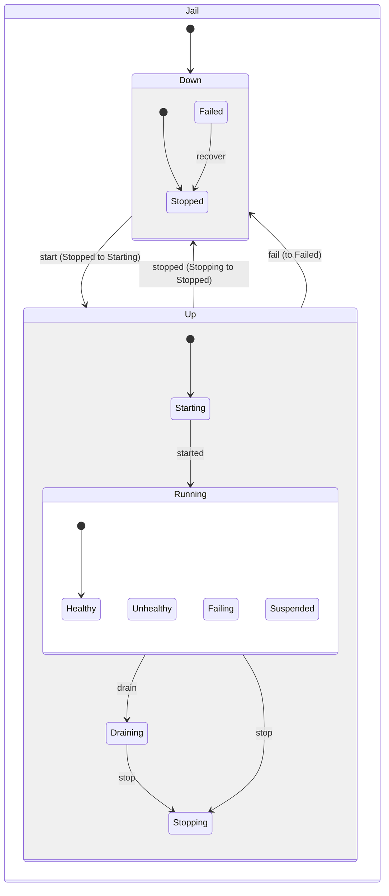

# Blackship

A FreeBSD jail orchestrator with TOML configuration, dependency management, state machine lifecycle control, and ZFS integration.

## Documentation

- [Blackship Technical Manual (PDF, latest release)](https://github.com/seuros/blackship/releases/latest/download/blackship-manual.pdf)

The README is the quick reference. The manual is built for every release and
attached to it: the complete operator guide, architecture, configuration,
command reference, integration, security model, and troubleshooting material.

## Features

- **Declarative Configuration**: Define jails in TOML with dependencies, networking, hooks, and resource limits
- **Dependency Management**: Real dependency-graph traversal for start/stop ordering; target jails by name, unambiguous prefix, tag, or ALL
- **State Machine Lifecycle**: Clean state transitions, devfs mounted per jail, /etc/rc boot and /etc/rc.shutdown on stop
- **Hot Updates (EVA)**: `blackship eva` diffs the config against running jails and applies parameter, rctl, and cpuset changes live via jail_set(JAIL_UPDATE) -- no restart, with drift warnings for changes that need one
- **VNET Networking**: epair (if_bridge) and native netgraph (ng_bridge) backends, named networks with automatic host gateway wiring, deterministic MAC addresses
- **Instant Provisioning**: releases bootstrap into datasets with a @pristine snapshot; jail roots are zfs clones, created in under a second
- **Jailfile Builds with Layer Cache**: every RUN/COPY is snapshotted; rebuilds resume from the longest cached prefix like a Docker layer cache
- **blackship commit**: freeze a configured jail into a reusable release (zero-copy snapshot + clone + promote)
- **pkgbase Bootstrap**: FreeBSD 16+ userlands from fingerprint-verified base package repos (automatic; --pkgbase opts in earlier)
- **Resource Limits**: rctl (memory, pcpu, maxproc, openfiles, ...) plus cpuset pinning with least-loaded core allocation
- **Health Checks & Supervision**: HTTP, TCP, and command checks; warden auto-restart; optional dead-man ping to healthchecks.io/Uptime Kuma
- **Migration & Import**: zfs send | ssh zfs receive between hosts with the jail definition staged inside the dataset; import from iocage, ezjail, or plain rootfs archives
- **Stats**: per-jail CPU, RSS, and process counts from jls/ps libxo JSON
- **Port Forwarding**: PF-based port exposure with source IP binding
- **Shell Completion**: Bash, Zsh, and Fish completions
- **Library API**: `Host`, `Container`, `Exec` and friends drive ephemeral jails from your own program (a CI runner, say); the CLI is built on the same calls
- **MCP Server**: `blackship mcp` (stdio, or Streamable HTTP with a bearer token) exposes host facts, the real parsers, and operator-approved file creation over MCP, so a model can author a `blackship.toml` or Jailfile against this host instead of guessing

## Requirements

- FreeBSD 15.0+ with jail support
- ZFS (optional, for snapshots/clones)
- PF (optional, for port forwarding)

Building from source also needs a C compiler and the base system headers:
the ioctl request codes and netgraph message constants are read out of
`/usr/include` at build time rather than hardcoded. Both ship with a
default FreeBSD install. The crate does not build on other operating
systems.

## Installation

```sh
# Install from crates.io
cargo install blackship

# Or download precompiled binary from releases
fetch https://github.com/seuros/blackship/releases/latest/download/blackship-freebsd-amd64.tar.gz
tar xzf blackship-freebsd-amd64.tar.gz
sudo mv blackship /usr/local/bin/

# Install shell completion (optional)
blackship completion bash > /usr/local/etc/bash_completion.d/blackship
blackship completion zsh > /usr/local/share/zsh/site-functions/_blackship
blackship completion fish > ~/.config/fish/completions/blackship.fish
```

## Default Paths

Blackship uses XDG-compliant user directories by default:

| Path | Default | Environment Override |
|------|---------|---------------------|
| `data_dir` | `~/.local/share/blackship` | `XDG_DATA_HOME` |
| `releases_dir` | `~/.local/share/blackship/releases` | - |
| `cache_dir` | `~/.cache/blackship` | `XDG_CACHE_HOME` |

These defaults allow running blackship without root for most operations. Override in `blackship.toml` for system-wide paths:

```toml
[config]
data_dir = "/var/blackship"
releases_dir = "/var/blackship/releases"
cache_dir = "/var/blackship/cache"
```

> **Note:** While paths are user-writable by default, `bootstrap` extraction requires root privileges because FreeBSD base archives contain root-owned files with special permissions (setuid binaries, etc.). Blackship will re-exec through FreeBSD's `mdo` when the current user has an applicable `mac_do` rule, then fall back to `doas` or `sudo`.

Automatic privilege escalation can be controlled globally:

```sh
# Fail instead of re-executing through mdo, doas, or sudo
blackship --no-escalate up --all

# Allow escalation, but never prompt for authentication
blackship --non-interactive up --all
```

`--non-interactive` passes `-n` to `doas` and `sudo`. FreeBSD's `mdo` is
already non-interactive: authorization comes entirely from `mac_do`, without a
password prompt. `--no-escalate` takes precedence when both options are used.

## Quick Start

### 1. Initialize Jailfile

```sh
# Create a Jailfile in current directory
blackship init

# Create with specific FreeBSD release
blackship init --release 15.1-RELEASE

# TOML format instead of Dockerfile-like
blackship init --toml
```

### 2. Initialize Armada Configuration

Create `blackship.toml`:

```toml
[config]
# Paths default to XDG directories (~/.local/share/blackship, ~/.cache/blackship)
# Uncomment to use system-wide paths:
# data_dir = "/var/blackship"
zfs_enabled = true
zpool = "zroot"
dataset = "blackship"

[[jails]]
name = "web"
release = "15.1-RELEASE"
hostname = "web.local"

[jails.network]
vnet = true
networks = ["default"]
bridge = "blackship0"
ip = "10.0.1.10"
gateway = "10.0.1.1"
```

Or use `blackship armada init` to generate a template.

### 3. Bootstrap a Release

```sh
# Download and extract FreeBSD base (requires root for extraction).
# With ZFS enabled the release lands in its own dataset with a @pristine
# snapshot, so jails clone-provision from it instantly.
blackship bootstrap 15.1-RELEASE

# FreeBSD 16 has no dist sets, so pkgbase is used automatically
# (16.0 is still -CURRENT; --pkgbase opts in on older branches)
blackship bootstrap 16.0-CURRENT

# List available releases
blackship releases
```

### 4. Create Network

```sh
# if_bridge network with gateway on the bridge (requires root)
blackship network create default --subnet 10.0.1.0/24 --gateway 10.0.1.1 --bridge blackship0

# netgraph network: ng_bridge plus a host-side gateway eiface, wired
# automatically; jails attached to it inherit the netgraph backend
blackship network create default --subnet 10.0.1.0/24 --backend netgraph --bridge ngbridge0
```

Networks persist across reboots: `blackship setup` (run by the warden rc
script at boot) recreates missing bridges and gateway interfaces. If PF is
not running yet, `blackship setup --enable-pf` writes a minimal pf.conf with
the blackship anchors, sets `pf_enable=YES`, and starts it. Jails reach
beyond the host only through a NAT rule you add; see
[Outbound traffic](#outbound-traffic).

Named networks created this way can be referenced from `blackship.toml` with
`[jails.network] networks = ["default"]`, and the same network can be used by
ephemeral jails with `blackship run --network default`. Those get the
host's `/etc/resolv.conf`, minus nameservers on the host's loopback that a
VNET stack cannot reach; when that leaves nothing (a host on
`local_unbound`), `run` refuses and asks for `--dns <ip>`.

### 5. Start Jails

```sh
# Start a specific jail
blackship up web

# Start all jails
blackship up --all

# Dry run (show what would happen)
blackship up --all --dry-run
```

### 6. Interact with Jails

```sh
# Open console
blackship console web

# Execute command
blackship exec web -- pkg install -y nginx

# Check status
blackship ps
blackship ps --json
```

## Using Blackship as a Library

Everything `blackship run`, `cp`, `rm`, `bootstrap`, `build` and `commit`
do is a library call first; the CLI is a thin coat of paint over it. A CI
runner (or anything else that wants throwaway jails) can depend on the crate
and skip the binary, the argument parser, the MCP server and the OTLP
exporter:

```toml
[dependencies]
blackship = { version = "0.3", default-features = false }
```

```rust
use blackship::{ContainerSpec, Exec, Host, Limits, Mount, Network, Selector};
use std::time::Duration;

let host = Host::new("/var/db/kim/blackship").with_zfs("zroot", "kim/blackship");

// Whatever a crashed run left behind goes first.
host.reap_orphans(&Selector::prefix("kim-"))?;
host.ensure_release("16.0-CURRENT")?;

let job = host.create(
    &ContainerSpec::new("kim-42", "16.0-CURRENT")
        .hostname("ci")
        .network(Network::Inherit)
        .limits(Limits::new().memory("4g").max_processes(512))
        .mount(Mount::read_only("/var/cache/kim/src/42", "/work"))
        .label("job", "42"),
)?;

let step = job.exec(
    Exec::shell("make test")
        .cwd("/work")
        .env("CI", "true")
        .timeout(Duration::from_secs(900))
        .on_output(|stream, bytes| print!("{stream:?}: {}", String::from_utf8_lossy(bytes))),
)?;
println!("exit: {:?}", step.exit);

job.copy_out("/work/report.xml", "/tmp/kim-42.xml")?;
job.destroy()?;
```

The rules of the road:

- **`Host`** is a description, not a connection: where releases,
  containers and state live, and which dataset backs them. Clone it freely;
  containers carry their own copy, so many can run on many threads with no
  shared mutable state.
- **Containers are ephemeral.** Dropping a `Container` destroys it. Call
  `keep()` to let it outlive the handle (that is what `run --detach` does),
  `hand_over(pid)` to give it to another process (a root helper creating
  containers for a daemon), and `destroy()` when you want to see the errors
  a drop would swallow.
- **Networking:** `Network::None` (the default), `Inherit` (the host's
  stack and resolver) or `Vnet(name)` (a leased address on a Blackship
  network and the host's resolver, minus loopback nameservers it cannot
  reach). `nameserver(ip)` overrides the resolver either way.
- **Mounts** are nullfs. `read_write` mounts are `nosuid` unless you call
  `allow_setuid()`; `noexec()` and `nosuid()` apply to either kind. These
  flags cover the jail-side mount only: the host path is as setuid-capable
  as its own filesystem, so keep host directories that jobs write to on a
  `setuid=off` dataset when other users can reach them.
- **`exec`** runs argv or `sh -c` with a clean environment, a working
  directory, and a timeout or deadline. Output is captured, streamed to a
  callback, or inherited. A non-zero exit is data, not an error. On timeout
  every process in the container is killed from the host side (`pkill -j`),
  so nothing inside can dodge it.
- **Destroy is idempotent** and works from any state: running, half-built,
  or left behind by a `kill -9`. It removes the jail, unmounts devfs and
  nullfs (refusing to delete anything while a mount is still live), releases
  the network lease, and destroys the clone.
- **Orphans** are containers whose creating process is gone. Each one is
  claimed with an ownership record before anything is built, so
  `orphans()` / `reap_orphans()` find them by name prefix or label after a
  crash. A handed-over container is an orphan once its new owner is gone.
  Kept containers have no owner and are never reaped.
- **Releases and images:** `releases()`, `has_release()`, `bootstrap()` and
  `ensure_release()` (FreeBSD 16 goes through fingerprint-verified pkgbase
  automatically). `build()` runs a Jailfile with the layer cache,
  `commit_image()` and `Container::commit()` freeze a root into a new
  release, and `remove_image()` / `remove_release()` clean up. Baking an
  image by installing base packages in a container needs
  `ContainerSpec::allow_chflags()`: pkgbase sets file flags.
- **Privilege:** library calls assume they already run as root and return
  `Error::NeedsRoot` otherwise. Only the CLI re-executes through `mdo`, `doas`,
  or `sudo`; callers can disable that with `--no-escalate` or prevent prompts
  with `--non-interactive`.
- **Errors** are one typed `blackship::Error` enum. No `anyhow` in sight.

`examples/ephemeral.rs` walks the whole lifecycle:

```sh
sudo cargo run --no-default-features --example ephemeral -- \
    --data-dir /var/db/blackship --zfs zroot/blackship --release 16.0-CURRENT
```

`tests/containers_as_root.rs` holds the end-to-end suite (timeouts, mounts,
orphan reaping, concurrency, build and commit); it runs only as root, against
a release you name:

```sh
sudo env BLACKSHIP_E2E_DATA_DIR=/var/tmp/bw BLACKSHIP_E2E_ZFS=zroot/blackship-e2e \
    BLACKSHIP_E2E_RELEASE=16.0-CURRENT \
    cargo test --test containers_as_root -- --ignored --test-threads=1
```

### Cargo features

| Feature | Default | What it brings |
|---------|---------|----------------|
| `cli` | yes | The `blackship` binary and its usage-rs parser; implies `telemetry` |
| `mcp` | yes | `blackship mcp` (mcp-host, schemars, tracing); implies `cli` |
| `telemetry` | via `cli` | OTLP export through rama; without it `[telemetry]` still parses and does nothing |
| `inspect` | no | state machine introspection |

## Machine-readable CLI

Automation can opt into a versioned JSON contract with the global
`--format json` option. As an inherited global, it works before or after the
selected command (`blackship --format json capabilities` and
`blackship capabilities --format json` are equivalent). The first contract
version covers the read-only commands most useful to management UIs:

```sh
blackship --format json ps
blackship --format json ps --host
blackship --format json check
blackship --format json capabilities
blackship --format json host
blackship --format json network list
blackship --format json ports
blackship --format json ports web
blackship --format json releases list
blackship --format json stats
blackship --format json stats web
blackship --format json health
blackship --format json health web
blackship --format json audit web
blackship --format json snapshot list web
blackship --format json armada ps
blackship --format json up web --dry-run
blackship --format json down web --dry-run
blackship --format json restart web --dry-run
blackship --format json eva web --dry-run
```

Successful commands write an envelope to standard output:

```json
{
  "schema_version": 1,
  "ok": true,
  "data": []
}
```

Failures, including command-line parsing errors, exit non-zero and write a
single JSON object to standard error. Error codes are stable identifiers
intended for program logic; messages remain for people and diagnostics:

```json
{
  "schema_version": 1,
  "ok": false,
  "error": {
    "code": "jail_not_found",
    "message": "Jail 'web' not found"
  }
}
```

Commands without a complete JSON contract fail with
`unsupported_output_format`; they never fall back to mixed human-readable
output. Streaming modes such as `health --watch` are intentionally excluded
from the single-envelope contract. Existing command-local flags such as
`blackship ps --json` retain their original, unenveloped output for
compatibility.

`blackship capabilities` requires neither a manifest nor root access. Its JSON
report lets clients discover the Blackship version, output schema, compiled
features, FreeBSD kernel capabilities, host facilities, and installed privilege
escalators before enabling UI actions. The `cli.machine_output` array lists
each exact command mode that supports the global JSON contract, using a stable
`operation` identifier plus its privilege and mutation behavior. Clients should
check for the operation instead of inferring support from the Blackship version:

```sh
blackship --format json capabilities \
  | jq '.data.cli.machine_output[] | select(.operation == "armada.ps")'
```

`blackship host` returns the same best-effort planning profile as the
`blackship:///host` MCP resource: kernel and facility capabilities, CPU and
memory capacity and claims, ZFS pools, releases, networks and available
addresses, PF state, manifest jails, and unmanaged running jails. Probes that
cannot run unprivileged report null or a local error instead of failing the
whole profile.

`blackship ps --host` adds running jails outside the selected manifest to the
configured Blackship inventory. Its result identifies each row's manager and
ownership, includes the selected project and config path, and keeps unknown
metadata null for unmanaged jails. Stopped unmanaged jails cannot be discovered
without a known manifest and are therefore not reported.

Lifecycle commands support the global JSON format in dry-run mode. Their
`data` object contains the requested operation and its ordered steps, allowing
management tools to preview dependency-aware changes without parsing terminal
text or modifying the host. Live lifecycle operations remain text-only.

## Configuration Reference

### Global Config

```toml
[config]
project = "orbital"                        # Jail name prefix (default: the config file's directory name)
# All paths are optional - defaults to XDG directories
data_dir = "~/.local/share/blackship"      # Base data directory (default)
releases_dir = "~/.local/share/blackship/releases"  # FreeBSD releases (default)
cache_dir = "~/.cache/blackship"           # Download cache (default)
mirror_url = "https://download.freebsd.org"  # FreeBSD mirror
zfs_enabled = true                         # Enable ZFS features
zpool = "zroot"                            # ZFS pool name
dataset = "blackship"                      # Base dataset name
monitor_ping_url = "https://hc-ping.com/…"  # Dead-man ping from the supervisor (optional)
```

With ZFS enabled the jails dataset is mounted at `data_dir/jails`, so jail
roots live at the same paths whether or not they are datasets. Blackship sets
that mountpoint only when it creates the dataset; every jail dataset carries
its own mountpoint, so a run with a different `data_dir` no longer drags the
shared parent along with it.

Running jails are named `<project>-<name>`: jail `web` in project `orbital`
runs as `orbital-web`, which is what `jls` and `ps` show. Commands take
either form. Without `project`, the name comes from the directory holding
`blackship.toml`, however you spell its path.

### Jail Definition

```toml
[[jails]]
name = "myapp"                        # Jail name (required)
release = "15.1-RELEASE"              # Base release (clone-provisioned when @pristine exists)
path = "/jails/myapp"                 # Custom path (optional; default data_dir/jails/<name>)
hostname = "myapp.local"              # Hostname
depends_on = ["database"]             # Dependencies
tags = ["web", "prod"]                # Tags for group targeting (blackship down prod)
devfs_ruleset = 4                     # devfs ruleset (default 4; 0 disables devfs)
init = true                           # Run /etc/rc at start, /etc/rc.shutdown at stop (default)
stop = "service nginx stop"           # Run inside the jail before teardown (overrides Jailfile STOP)

[jails.resources]
memory = "1g"                         # rctl memoryuse:deny
cpu = "150"                           # rctl pcpu:deny (percent)
maxproc = 200                         # rctl maxproc:deny
cores = 2                             # Pin to N least-loaded CPUs
# cpuset = "0,1"                      # Or pin to an explicit CPU list

[jails.network]
vnet = true                           # Enable VNET
networks = ["default"]                # Named networks to attach to
bridge = "blackship0"                 # Optional if runtime network state defines a bridge
ip = "10.0.1.10"                      # Static IP, or omit for auto-assignment
gateway = "10.0.1.1"                  # Optional if resolved from named network
mac_address = "02:00:00:00:00:01"     # Static MAC (default: deterministic from jail name)
# backend = "netgraph"                # Inherited from the named network when omitted
# shared = true                       # Share the host's network (ip4=inherit); ignored if vnet=true

[jails.network.dns]
nameservers = ["8.8.8.8", "8.8.4.4"]  # DNS servers
mode = "custom"                        # custom or inherit

[jails.healthcheck]
enabled = true

[[jails.healthcheck.checks]]
name = "http"
command = "curl -sf http://localhost:80/health"
target = "jail"
interval = 30
timeout = 10
retries = 3

[[jails.healthcheck.checks]]
name = "process"
command = "pgrep nginx"
target = "jail"

[[jails.hooks]]
phase = "pre_start"                   # pre_create, post_create, pre_start, post_start,
target = "host"                       # pre_stop, post_stop, pre_eva, post_eva
command = "/usr/local/bin/fetch-secrets"  # A program, not a shell line
args = ["${jail_name}"]               # also ${jail_path}, ${jail_ip}, ${jid}
on_failure = "abort"                  # abort or continue

[[jails.hooks]]
phase = "pre_stop"
target = "jail"
command = "/usr/sbin/service"
args = ["nginx", "stop"]
on_failure = "continue"
```

A hook's `command` is executed directly, with `args` as its arguments; it is
not passed through a shell, so `command = "service nginx stop"` looks for a
program by that whole name. Wrap shell syntax yourself:
`command = "/bin/sh"`, `args = ["-c", "..."]`. `post_start` hooks run after
the jail is up, so `on_failure = "abort"` there only warns: the jail keeps
running.

## Commands

### Lifecycle

| Command | Description |
|---------|-------------|
| `blackship up [target] [--all] [--dry-run]` | Start jail(s) with dependencies |
| `blackship down [target] [--all] [--dry-run]` | Stop jail(s) in reverse order |
| `blackship restart [target] [--all] [--dry-run]` | Restart jail(s) |
| `blackship eva [target] [--all] [--dry-run]` | Hot-update running jail(s) to match the config, no restart |

Targets accept a jail name, an unambiguous prefix, a tag (from `tags = [...]`
in the jail definition), or `ALL`.

`eva` recomputes each jail's parameters from the config, diffs them against
the live values from jls, and applies only the changes in one
jail_set(JAIL_UPDATE) call. rctl rules are replaced only when they differ from
what the kernel holds (sizes compared in bytes), and the cpuset is re-pinned.
`path`, `vnet`, and IP addresses cannot change live: drift on those, including
a VNET jail's address read from inside its stack, is reported as a
restart-required warning and skipped. Not-running jails are skipped.
`--dry-run` prints the diff without touching anything; run unprivileged, it
cannot read a VNET address or the kernel's rctl rules and lists them as
"could not be read, not verified".

| Command | Description |
|---------|-------------|
| `blackship ps [--host] [--json]` | List manifest jail status; `--host` also includes other running host jails |
| `blackship check` | Validate configuration; warn on jail releases not bootstrapped |
| `blackship capabilities` | Report binary and host capabilities |
| `blackship host` | Report the comprehensive host planning profile as JSON |
| `blackship setup [--enable-pf]` | Reapply networks and PF anchors; --enable-pf turns PF on |
| `blackship cleanup <jail> [--force]` | Clean up failed jail resources |
| `blackship init [-f file] [--release] [--toml]` | Create a new Jailfile |

### Console & Execution

| Command | Description |
|---------|-------------|
| `blackship console <jail> [-u user]` | Open interactive shell |
| `blackship exec <jail> [-u user] [-w dir] [-e K=V] [--clear-env] -- <cmd>` | Execute command in jail (`--clear-env` starts from an empty environment, keeping only `-e` values) |
| `blackship run --name <n> --release <r> [--network <net>] [--dns <ip>] -- <cmd>` | Run a command in an ephemeral jail, removed when it exits |
| `blackship run --name <n> --release <r> [--network <net>] [--dns <ip>] -d` | Start an ephemeral jail and leave it running (no command; use `exec`, then `rm`) |

### File Operations

| Command | Description |
|---------|-------------|
| `blackship cp <src> <dest>` | Copy files (`jail:path` for jail paths; short or full jail name) |
| `blackship rm <jails...> [-f] [--volumes]` | Remove/destroy jails; exits non-zero if any was not removed (missing, or running without `-f`) |

### Bootstrap & Releases

| Command | Description |
|---------|-------------|
| `blackship bootstrap <release> [-f] [-a archives] [--pkgbase]` | Download FreeBSD release (pkgbase automatic for 16+) |
| `blackship releases [list\|delete\|verify] [--json]` | Manage releases |

### Networking

| Command | Description |
|---------|-------------|
| `blackship network create <name> -s <subnet> [-g gw] [-b bridge] [--backend epair\|netgraph]` | Create network (requires root) |
| `blackship network destroy <name> [--force]` | Destroy network (requires root) |
| `blackship network list` | List Blackship-managed networks |
| `blackship expose <jail> -p <port> [-I bind-ip] [--proto tcp\|udp]` | Expose port |
| `blackship ports [jail]` | List exposed ports |

### Snapshots & Clones (requires ZFS)

| Command | Description |
|---------|-------------|
| `blackship snapshot create <jail> [name]` | Create snapshot |
| `blackship snapshot list <jail> [--json]` | List snapshots |
| `blackship snapshot rollback <jail> <snap> [--force]` | Rollback to snapshot |
| `blackship snapshot delete <jail> <snap>` | Delete snapshot |
| `blackship clone <jail>@<snap> <newname>` | Clone from snapshot |
| `blackship commit <jail> <release>` | Freeze a jail into a reusable release (zero-copy) |

Snapshots (and commits) stage the jail definition at `.blackship/` inside
the dataset, so `zfs send` carries everything needed to rebuild the jail.

### Export & Import

| Command | Description |
|---------|-------------|
| `blackship export <jail> [-o file] [--zfs-send]` | Export to archive |
| `blackship import <file> [-n name] [--force]` | Import from archive |
| `blackship import <file> --from iocage\|ezjail\|rootfs\|auto [-n name]` | Import from another jail manager |
| `blackship migrate <jail> user@host [--remote-dataset ds]` | Move a jail to another host over ssh |

### Build System

| Command | Description |
|---------|-------------|
| `blackship build [-f Jailfile] [-n name] [--build-arg K=V] [--dry-run]` | Build from Jailfile (ZFS layer cache: unchanged steps print CACHED) |
| `blackship template list` | List templates |
| `blackship template inspect <file>` | Show Jailfile details |
| `blackship template validate <file>` | Validate Jailfile |

### Health & Monitoring

| Command | Description |
|---------|-------------|
| `blackship health [jail] [-w] [-i interval] [--json]` | Health check status |
| `blackship stats [jail] [--json]` | Per-jail CPU, RSS, and process counts |
| `blackship supervise` | Start Warden supervisor for auto-restart |
| `blackship logs <jail> [-f] [-n lines]` | Tail jail logs |
| `blackship audit <jail> [--json]` | Durable lifecycle history, peak usage, exit reason |
| `blackship qos <jail> [--show\|--steady\|--startup]` | Inspect or switch the QoS profile |
| `blackship gc [jail] [--dry-run] [--force] [--json]` | Reclaim orphaned jail resources |

### Armada (Multi-Jail Orchestration)

| Command | Description |
|---------|-------------|
| `blackship armada init [-f file]` | Create a new blackship.toml |
| `blackship armada up [-d] [jails...]` | Start all jails |
| `blackship armada down [jails...]` | Stop all jails |
| `blackship armada build [jails...]` | Build jails from Jailfiles |
| `blackship armada ps [--json]` | Show status of all jails |
| `blackship armada config [--show]` | Validate and show configuration |

#### Config File Merging

Armada supports merging multiple config files (later files override earlier):

```sh
# Merge base config with production overrides
blackship armada -f base.toml -f prod.toml up

# Merge multiple files
blackship armada -f base.toml -f secrets.toml -f local.toml up
```

#### Jailfile References

Jails in `blackship.toml` can reference Jailfiles for building:

```toml
[[jails]]
name = "web"
build = "./web"              # Directory containing Jailfile
depends_on = ["db"]

[[jails]]
name = "api"
jailfile = "./custom/Api.jailfile"  # Explicit Jailfile path
```

### Shell Completion

| Command | Description |
|---------|-------------|
| `blackship completion bash\|zsh\|fish` | Generate shell completion |

### MCP Server

| Command | Description |
|---------|-------------|
| `blackship mcp [--listen addr:port]` | Serve MCP on stdio, or Streamable HTTP with `--listen` (see [MCP Server](#mcp-server-1)) |

## Jailfile Format

Jailfiles define reproducible jail builds, similar to Dockerfiles:

```dockerfile
# Jailfile
FROM 15.1-RELEASE

# Labels (metadata)
LABEL name=nginx-jail version=1.0

# Build arguments
ARG NGINX_VERSION=1.30

# Environment variables
ENV NGINX_VERSION=${NGINX_VERSION}

# Run commands (executed via jexec)
RUN pkg install -y -g "nginx-${NGINX_VERSION}*"
RUN sysrc nginx_enable=YES

# Copy files from build context
COPY nginx.conf /usr/local/etc/nginx/nginx.conf
COPY html/ /usr/local/www/html/

# Set working directory
WORKDIR /usr/local/www

# Expose ports (documentation)
EXPOSE 80/tcp
EXPOSE 443/tcp

# Default command
CMD /usr/local/sbin/nginx -g 'daemon off;'

# Run inside the jail before teardown
STOP /usr/local/sbin/nginx -s quit
```

`STOP` runs before `/etc/rc.shutdown` when the jail is stopped. A `stop =` key on
the jail in `blackship.toml` overrides it.

### TOML Format (Alternative)

```toml
# Jailfile.toml
[metadata]
name = "nginx-jail"
version = "1.0"

[build]
from = "15.1-RELEASE"

[[build.args]]
name = "NGINX_VERSION"
default = "1.30"

[[build.run]]
command = 'pkg install -y -g "nginx-${NGINX_VERSION}*"'

[[build.copy]]
src = "nginx.conf"
dest = "/usr/local/etc/nginx/nginx.conf"
owner = "root:wheel"
mode = 0o644

[[build.expose]]
port = 80
protocol = "tcp"

[start]
cmd = "/usr/local/sbin/nginx -g 'daemon off;'"

[stop]
cmd = "/usr/local/sbin/nginx -s quit"
```

The TOML format runs its steps in a fixed order, whatever order the tables
appear in: `from`, `workdir`, `args`, `env`, every `run`, every `copy`, then
`expose`. No `run` can act on a copied file, so set ownership and permissions on
the `copy` entry itself (`owner`, `mode`); when a command must follow a copy,
use the line format, which keeps the order as written. Unknown keys are
rejected rather than ignored.

### Build Commands

```sh
# Basic build
blackship build -f Jailfile -n myjail

# With build arguments
blackship build -f Jailfile -n myjail --build-arg NGINX_VERSION=1.30

# Dry run
blackship build -f Jailfile --dry-run
```

## ZFS Integration

ZFS is what makes jails cheap. With `zfs_enabled = true`:

1. Releases bootstrap into their own dataset and get a `@pristine` snapshot
2. Jail roots are `zfs clone`s of that snapshot, so creation is near-instant
   and jails share the base blocks instead of copying them
3. Jailfile builds snapshot each step, giving rebuilds a layer cache
4. `blackship commit` freezes a jail back into a reusable release
5. Snapshots carry the jail's own definition, and send/receive moves jails
   between hosts

The jails dataset is mounted at `data_dir/jails`, so a jail root is at the
same path whether or not it is a dataset. Without ZFS everything still works,
but each jail is a full copy of the release (Blackship refuses the copy if the
filesystem cannot take it).

### Instant provisioning and commit

```sh
# Bootstrap once: extracts to a dataset, snapshots it @pristine
blackship bootstrap 15.1-RELEASE

# Jails clone from it: sub-second, and nearly free on disk
blackship up web

# Configure a jail, then freeze it into a reusable release
blackship build -f Jailfile -n runner
blackship commit runner runner-golden

# Everything cloned from it starts pre-configured
blackship run --name ci-1 --release runner-golden -- ./run-tests.sh
```

`commit` promotes the new release so it no longer depends on the jail. A side
effect of `zfs promote`: snapshots the jail took before the commit move to
the release, and the jail can no longer roll back to them.

### Build layer cache

Every `RUN` and `COPY` is snapshotted as `bs-layer-<n>-<hash>`, keyed by a
rolling hash of the instructions before it, the build arguments, the base
release, and the contents of anything copied in. A rebuild rolls back to the
longest cached prefix and continues from there:

```
$ blackship build -f runner/Jailfile -n runner
CACHED steps 1-5 (layer bs-layer-4-a1aadc5d826c)
Build complete! Jail root: /var/blackship/jails/armada-runner
```

Change a line in the Jailfile and only that step and everything after it
re-runs, exactly like a Docker layer cache.

### Snapshot Workflow

Snapshots stage the jail's definition (and its Jailfile, when known) at
`.blackship/` inside the dataset first, so a `zfs send` of the snapshot
carries everything needed to rebuild the jail elsewhere.

```sh
# Create snapshot before changes
blackship snapshot create web pre-update

# Make changes
blackship exec web -- pkg upgrade -y

# If something breaks, rollback
blackship down web
blackship snapshot rollback web pre-update --force
blackship up web

# Clone for testing
blackship clone web@pre-update web-test
```

### Export/Import with ZFS

```sh
# Fast export using ZFS send
blackship export web -o web-backup.zfs --zfs-send

# Standard tar.zst export (bsdtar: hardlinks and file flags kept, sockets
# skipped, devfs and other mounts left out; a failed export leaves no file)
blackship export web -o web-backup.tar.zst

# Import (auto-detects format)
blackship import web-backup.tar.zst --name web-restored

# Import from another jail manager
blackship import old-jail.zip --from iocage --name legacy

# Move a stopped jail to another host over ssh
blackship migrate web seuros@otherbox
```

`migrate` runs as root, so the ssh connection uses root's keys and
`known_hosts`, not yours: set those up for the target first.

## Networking

Every VNET jail gets its own network stack and one interface plugged into a
host bridge. Blackship implements that two ways, and a *named network* picks
which one:

| | `epair` (default) | `netgraph` |
|---|---|---|
| Host bridge | `if_bridge` | `ng_bridge` node |
| Jail interface | `if_epair` pair (`epair0a`/`epair0b`) | `ng_eiface` (`ngethN`) |
| Gateway lives on | the bridge interface | a host-side `ng_eiface` |
| VLAN tagging | supported | not supported |

### Named networks

A named network is a persisted record (subnet, gateway, bridge, backend), not
a live interface. Creating one realizes it on the host; `blackship setup`
re-realizes it after a reboot, when bridges and eifaces are gone but the
record remains:

```sh
blackship network create default --subnet 10.0.1.0/24 --backend netgraph --bridge ngbridge0
```

```
Created network 'default' on bridge 'ngbridge0' (netgraph)
  Subnet: 10.0.1.0/24
  Gateway: 10.0.1.1
  Host gateway interface: ngeth0
```

Jails attach by name and inherit the backend, so nothing in the jail
definition needs to know which dataplane is in use:

```toml
[jails.network]
vnet = true
networks = ["default"]
ip = "10.0.1.10"
```

### How the netgraph backend is wired

`ng_bridge` is a kernel graph node with numbered `linkN` hooks. Blackship
hangs one `ng_eiface` off a hook per jail, plus one for the host itself,
which is where the gateway address lives:

```
                          ng_bridge (ngbridge0)
                          ├── link0 ── ng_eiface ngeth0   [host]  10.0.1.1
                          ├── link1 ── ng_eiface ngeth1   [jail web]  10.0.1.10
                          └── link2 ── ng_eiface ngeth2   [jail db]   10.0.1.11
host NIC (em0) ── PF NAT ── routing ── ngeth0
```

There is no epair pair and no `if_bridge`: the jail interface is moved into
the jail's vnet with `SIOCSIFVNET`, and traffic reaches the outside through
normal host routing plus a NAT rule (see [Outbound traffic](#outbound-traffic)).

### Outbound traffic

Both backends route jail traffic through the host gateway, and Blackship
does not install NAT. Blackship sets `net.inet.ip.forwarding=1` when it
realizes a gateway; reaching anything beyond the host takes a NAT rule per
subnet in `pf.conf`, on the interface that carries the default route:

```
nat on $ext_if inet from 10.0.1.0/24 to any -> ($ext_if)
```

Without it, jails reach the gateway and each other, and nothing else.

Concurrent jail creation is safe: two creators racing for the same free
`linkN` retry the next index, and IP claims are arbitrated by the lease store
under a lock rather than by whoever wrote last.

### Interface ownership

Host-side interfaces are tagged into the `blackship` interface group
(`ifconfig -g blackship` lists them). Cleanup checks that tag before
destroying an interface it found by name, so a recycled name belonging to
something else is never torn down. Only the host end is tagged, because
moving an interface into a vnet strips its groups.

Jail interfaces also get a deterministic MAC by default: the FreeBSD OUI
`58:9c:fc` plus a hash of the jail name and bridge, so an address survives
restarts and differs between clones. Set `mac_address` to override.

### Gotcha: one namespace, two bridge types

Loading `ng_ether` gives every ethernet interface a netgraph node named after
itself, and that includes `if_bridge` interfaces. A named network created
with the epair backend on `blackship0` therefore occupies the name
`blackship0` in the netgraph namespace too, and a netgraph bridge cannot then
use it:

```
Error: Network error: NgNameNode(.:bridge_tmp, blackship0) failed: Address already in use
```

Give the two backends distinct bridge names (`blackship0` and `ngbridge0`).

### Port Forwarding

Uses PF anchors to avoid modifying `/etc/pf.conf`:

```sh
# Expose nginx on port 80
blackship expose web -p 80

# Expose on specific host IP
blackship expose web -p 443 -I 192.168.1.100

# Different internal port
blackship expose web -p 8080 --internal 80
```

Add to `/etc/pf.conf` (`blackship setup --enable-pf` writes a minimal one
with these lines when none exists):
```
rdr-anchor "blackship"
anchor "blackship"
```

The `blackship` anchor also references the per-jail drain anchors, so these
two lines cover `[jails.drain]` and `cascade = "isolate"` as well.

Port forwards are persisted under Blackship's data directory. After a PF
restart or host reboot, run `blackship setup` to recreate the anchor and
reapply the saved rules.

## Health Checks

All health checks are command-based (exit 0 = healthy).

### HTTP Check

```toml
[[jails.healthcheck.checks]]
name = "api"
command = "curl -sf http://localhost:8080/health"
target = "jail"
interval = 30
timeout = 10
```

### TCP Check

```toml
[[jails.healthcheck.checks]]
name = "postgres"
command = "nc -z localhost 5432"
target = "jail"
```

### Command Check

```toml
[[jails.healthcheck.checks]]
name = "nginx-running"
command = "service nginx status"
target = "jail"
```

### Suspicion instead of retry counting

By default a check is Failing after `retries` consecutive failures. For flaky
probes you can opt in to a phi-accrual detector per check:

```toml
[[jails.healthcheck.checks]]
name = "api"
command = "curl -sf http://localhost:8080/health"
target = "jail"
interval = 5

[jails.healthcheck.checks.suspicion]
min_samples = 8        # passing checks before phi is reported (default 8, at most 64)
unhealthy_phi = 3.0    # a failed check reports unhealthy at this phi (default 3.0)
failing_phi = 8.0      # ... and failing at this one (default 8.0)
# min_std_dev_ms = 1250  # deviation floor; default is a quarter of `interval`
```

A passing check is a heartbeat; a failing check is silence. The detector
measures how long the check has been silent relative to how regular its passes
were, and a failed check is only reported once that silence is unusual. Below
`unhealthy_phi` a failed check stays healthy, between the two it is
`unhealthy`, and at `failing_phi` it is `failing`. Until `min_samples` passes
have been seen, the check falls back to plain retry counting. Only a failing
verdict can trigger the check's `recovery` action; suspicion reports a level
and never restarts anything by itself. Breakers and rate limits are unchanged.
Leave the table out and nothing changes. `unhealthy_phi` and `failing_phi`
must be positive and `unhealthy_phi <= failing_phi`; bad values are rejected
at load.

### Bounding concurrent checks

Under `supervise`, every jail's monitor runs its checks on its own. To keep a
slow host from being buried by its own probes, cap them:

```toml
[config.rate_limit.health_concurrency]
initial = 4      # runs allowed in flight at the start (default 4)
min = 1          # the limit never drops below this (default 1)
max = 1000       # never grows above this (default 1000)
```

The limit moves by additive-increase, multiplicative-decrease: it grows by one
when a run completes while the limit is saturated, and drops to three quarters
when a run errors or takes at least half of its check `timeout`. A cycle that
finds the limit full is shed, not queued: the monitor skips it and tries again
on its next interval. Unset means unbounded, exactly as before. This applies
to `supervise` health monitors only; `up` and `down` start and stop jails one
at a time.

### Monitoring

`health` runs checks inside the jail, so it escalates to root like `exec`.
`start_period` (default 60s) counts from when the jail started, so a one-time
check on a jail that has been up for a while reports real results; within the
start period it reports `starting`, and a jail that is not running reports
`unknown`.

```sh
# One-time check
blackship health web

# Watch mode (updates every 5 seconds)
blackship health --watch --interval 5

# JSON output for scripting
blackship health --json
```

## Lifecycle state, reclamation, and telemetry

Every host mutation `up` performs is checkpointed to a scope record at
`<data_dir>/scope/<jail>.toml` *before* it happens, and every transition is
appended to `<data_dir>/audit/<jail>.jsonl`. The scope record is the reclamation
work-list; the audit log outlives it.

### Reclaiming orphans

A jail killed out of band (`jail -r`, a panic, a hard reset) leaves its epair,
rctl rules, lease, mounts, and dataset behind. `gc` finds them by diffing scope
records against what is actually running:

```sh
blackship gc --dry-run          # report only
blackship gc                    # reap what blackship provably owns
blackship gc --force            # also release resources it cannot prove it owns
```

Datasets blackship did not create, and jails marked `ephemeral = false`, are
reported but never destroyed without `--force`. `up` and `supervise` run the
report-and-reap-orphans half automatically.

Blackship tags every jail dataset it creates with the ZFS property
`blackship:ephemeral`. A jail that is stopped and started again reuses its
dataset, and the tag lets the new scope record claim it again, so a supervisor
that dies after a restart is still cleaned up by `gc`. A dataset without the
tag (say, one from `build`) is never claimed that way.

`gc` also reclaims a bridge that blackship created for a VNET jail once nothing
uses it, no `--force` needed. It must be tagged into the `blackship` interface
group (blackship tags a bridge only when it creates it), have no members, and
be named by no network record, no live jail's VNET record and no
`[config.bridge]`. Bridges that predate the tag, bridges you made yourself,
and the `[config.bridge]` one are never touched, and `ng_bridge` is not
handled.

### Jail state as a chart

Lifecycle and health live in one statechart, so the order things are left and
entered is resolved by the chart, not by hand:



The arrows are the `state-machines` events. `fail` leaves any Up state for
Failed, and `start` and `stopped` are the Stopped-to-Starting and
Stopping-to-Stopped moves between the two groups. Supervisor health verdicts
move the leaf among the four Running states in any direction.

Events and guards stay in the `state-machines` jail machine; the chart answers
which states a move exits and enters. `fail` from a healthy running jail exits
Healthy, Running and Up, then enters Down and Failed. Health verdicts from
`supervise` move the leaf inside Running, and `stop` releases what leaving Up
held (VNET, then the address lease) in the order the chart reports.

### Two-phase QoS

A jail usually needs headroom while it warms caches and forks workers, and a
tighter cap once it settles. `[jails.qos]` gives it both:

```toml
[jails.qos]
transition = "healthy"      # "healthy" | "timer" | "manual"
max_startup_secs = 120

[jails.qos.startup]
memory = "4g"
cpu = "400"

[jails.qos.steady]
memory = "2g"
cpu = "200"
```

The `healthy` transition fires on the first passing healthcheck and therefore
needs `blackship supervise`; `max_startup_secs` is its fallback deadline. For
one-shot `blackship up` there is no warden, so shift by hand:

```sh
blackship qos web --show
blackship qos web --steady
```

Only the resources a profile names are swapped — custom `rules` entries survive
the shift, and `eva` reconciles against the *recorded* phase rather than
reverting it.

### Draining and cascade policy

`[jails.drain]` blocks new TCP connections through a per-jail PF sub-anchor
(`blackship/drain/<jail>`) and waits for established states to close before
teardown, up to `timeout_secs`. `cascade` decides what happens to dependents on
`down`: `strict` stops them (default), `detach` stops only the target, `isolate`
leaves them running but fences them off at the firewall.

### Post-mortem

```sh
blackship audit web
blackship audit web --json
```

This reads the durable JSONL, so it still answers after the jail, its scope
record, and a reboot are gone — including peak racct usage sampled by the
supervisor and the recorded termination reason. Peaks are bounded by
`usage_sample_secs` (default 30s); they are sampled maxima, not exact kernel
counters.

### OTLP export

Adding a `[telemetry]` block sends the same event stream to a collector over
OTLP/HTTP, alongside racct gauges:

```toml
[telemetry]
endpoint = "http://127.0.0.1:4318"
service_name = "blackship"
metrics_interval_secs = 30

[telemetry.headers]
authorization = "Bearer <token>"
```

Omitting the table costs nothing: no exporter is built, no runtime is started,
no socket is opened. A collector that is down, slow, or misconfigured warns once
and never fails a jail operation.

## Dependencies

`up` starts a jail after everything it depends on; `down` stops a jail after
everything that depends on it (with the default `cascade = "strict"`). Jails
already in the target state are skipped, and `restart` brings back the
dependents its stop took down:

```toml
[[jails]]
name = "app"
depends_on = ["cache", "database"]

[[jails]]
name = "cache"

[[jails]]
name = "database"
```

```sh
# Starts: cache → database → app (siblings in depends_on order)
blackship up app

# Stops: app → database (app depends on it)
blackship down database

# Stops only app: nothing depends on it
blackship down app
```

## Examples

### Web Application Stack

```toml
[config]
# data_dir defaults to ~/.local/share/blackship
zfs_enabled = true
zpool = "zroot"
dataset = "blackship"

[[jails]]
name = "postgres"
release = "15.1-RELEASE"
hostname = "db.local"
[jails.network]
vnet = true
bridge = "blackship0"
ip = "10.0.1.10"
gateway = "10.0.1.1"

[[jails]]
name = "redis"
release = "15.1-RELEASE"
hostname = "cache.local"
[jails.network]
vnet = true
bridge = "blackship0"
ip = "10.0.1.11"
gateway = "10.0.1.1"

[[jails]]
name = "webapp"
release = "15.1-RELEASE"
hostname = "app.local"
depends_on = ["postgres", "redis"]
[jails.network]
vnet = true
bridge = "blackship0"
ip = "10.0.1.20"
gateway = "10.0.1.1"
[jails.network.dns]
nameservers = ["8.8.8.8"]
mode = "custom"

[jails.healthcheck]
enabled = true

[[jails.healthcheck.checks]]
name = "http"
command = "curl -sf http://localhost:3000/health"
target = "jail"
interval = 30
```

### Backup and Migration

```sh
# Create snapshot
blackship snapshot create webapp v1.0

# Export for migration
blackship export webapp -o webapp-v1.0.tar.zst

# On new host
blackship import webapp-v1.0.tar.zst --name webapp
# Edit blackship.toml to add jail config
blackship up webapp
```

## CI/CD Integration (Example)

This is an example of how Blackship could be used as a backend for CI/CD systems. This is not a built-in integration - it demonstrates how the `run`, `exec`, `cp`, and `rm` commands can be combined for CI/CD workflows.

### Example: Gitea Actions with act_runner

Blackship could be used as a backend for [Gitea Actions](https://docs.gitea.com/usage/actions/overview) via [act_runner](https://gitea.com/gitea/act_runner).

#### Setup

1. Bootstrap a release:
```sh
blackship bootstrap 15.1-RELEASE
```

2. Configure act_runner with jail labels:
```yaml
runner:
  labels:
    - "freebsd-15:jail://15.1-RELEASE"
```

3. Workflows targeting `runs-on: freebsd-15` would execute in ephemeral jails.

#### How it Would Work

When act_runner receives a job with a `jail://` label, the runner could:
1. Create an ephemeral jail via `blackship run --name gitea-runner-<id> --release <release> --detach`
2. Clone the repository into the jail using `blackship cp`
3. Execute each step via `blackship exec <jail> --workdir /workspace -- <command>`
4. Clean up via `blackship rm <jail> --force`

**Note:** This requires custom act_runner configuration or a wrapper script - it is not built into act_runner by default.

## MCP Server

`blackship mcp` speaks the [Model Context Protocol](https://modelcontextprotocol.io)
over stdin/stdout, or over Streamable HTTP with `--listen`, so an MCP-capable assistant can author jail configuration
for *this* host. Writing a `blackship.toml` or a Jailfile by hand means knowing
two schemas and knowing what the host can actually do; the server supplies both,
plus the real parsers, so a draft is checked before it reaches disk.

It is built by default. Compile without it using `--no-default-features`.

### Running it

```sh
blackship mcp
```

It needs no root, and it does not require a `blackship.toml` to exist --
creating one is the point. Register it with a client:

```json
{
  "mcpServers": {
    "blackship": {
      "command": "blackship",
      "args": ["mcp"]
    }
  }
}
```

Pass `--config <path>` before `mcp` to change the manifest path the tools
default to. Stdout carries the JSON-RPC frame stream, so diagnostics go to
`$XDG_DATA_HOME/blackship/mcp.log` (by default
`~/.local/share/blackship/mcp.log`) instead; set `RUST_LOG` to raise the level.

### Over HTTP

`--listen` serves the same tools, prompts and resources as Streamable HTTP at
`/mcp`, so an assistant on another machine can author configuration for this
host:

```sh
# Loopback: no token needed; Host/Origin checks guard against DNS rebinding
blackship mcp --listen 127.0.0.1:7340

# Any other address requires a bearer token
BLACKSHIP_MCP_TOKEN=$(openssl rand -hex 24) blackship mcp --listen 192.168.1.10:7340
```

```json
{
  "mcpServers": {
    "blackship": {
      "type": "http",
      "url": "http://192.168.1.10:7340/mcp",
      "headers": { "Authorization": "Bearer <token>" }
    }
  }
}
```

The token comes from the environment, never from argv, so it does not show up
in `ps`. Without it, `--listen` on a non-loopback address refuses to start.
`blackship:///host` describes the host and the creating tools write files on
it, so treat the token like a login. The write gate works the same over HTTP: the
approval prompt reaches the client on the session's stream, and a client that
does not declare elicitation gets a refusal and no file. The server speaks
plain HTTP; put TLS in front of it (a reverse proxy, or an ssh tunnel to the
loopback listener) when the network between you and the host is not trusted.

### Tools

Read-only, no approval needed:

| Tool | Returns |
|------|---------|
| `manifest_inspect` | The parsed manifest as JSON |
| `manifest_validate` | Every diagnostic, staged read -> parse -> validate |
| `jailfile_inspect` | The parsed Jailfile as JSON |
| `jailfile_validate` | Every bad line with line and column, in one call |

File-producing, and approval is not optional:

| Tool | Writes |
|------|--------|
| `manifest_create` | A `blackship.toml` rendered from a project name and a list of jails |
| `jailfile_create` | A Jailfile in the TOML format |

Facts about the host are a resource, `blackship:///host`, not a tool: one
source, read before planning. Output is compact JSON; the reader is a model.

### Writes are gated on the operator

Neither creating tool can write a file on its own authority. Both render the
text, validate it through the same code `blackship up` and `blackship build`
use, and then ask **you** through an MCP
[elicitation](https://modelcontextprotocol.io/specification/server/elicitation).
Nothing lands on disk unless you set `confirm`, and replacing an existing file
additionally needs `overwrite`, which is only ever offered when the file really
exists. The prompt names the absolute path.

The gate fails closed. A declined or cancelled request, a form returned without
`confirm`, a client that does not support elicitation, a prompt left unanswered
for two minutes, a target directory that does not exist, and a draft that does
not validate all produce the same result on disk: nothing. A refusal comes back
as a payload with `"written": false` and a reason, so the model can tell a
rejection from an error.

Writes themselves go through a temp file in the target directory followed by a
rename, so an interrupted write cannot truncate an existing manifest. That is
also why the target's directory has to exist: it is checked before you are
asked, so an approval is never spent on a write that cannot land. blackship
does not create directories on your behalf.

### Prompts

The prompts carry the workflow -- they tell the model which tools to call and in
what order, rather than leaving it to infer that.

| Prompt | Purpose |
|--------|---------|
| `new_project` | Author a `blackship.toml`: gather host facts, draft, validate, then create |
| `new_jailfile` | The same arc, ending at `jailfile_create` |
| `diagnose_config` | Explain why an existing file is rejected, in terms of the schema |

### Resources

| URI | Contents |
|-----|----------|
| `blackship:///host` | The live host: FreeBSD version and kernel features, CPU, memory (physical, free, ARC, swap) and what manifest jails claim, ZFS pools and free space, networks with used and free addresses, PF state and the NAT egress interface, releases, manifest and unmanaged jails |
| `blackship:///man` | The CLI manual, generated from the live command spec (stdio only) |
| `blackship:///man.kdl` | The full command tree as KDL (stdio only) |
| `blackship:///schema/manifest` | JSON Schema for what `manifest_create` accepts |
| `blackship:///schema/jailfile` | JSON Schema for what `jailfile_create` accepts |
| `blackship:///reference/jailfile` | The line-format keywords, including which Dockerfile constructs do **not** exist here |
| `blackship:///reference/jail-params` | The reserved `jail_set(2)` parameters blackship manages itself |

The manual and the schemas are generated, not hand-written, so a new subcommand
or a new parameter shows up the day it is added and cannot drift out of date.
Over HTTP the client is remote and cannot run the CLI, so the manual is not
served there. A value the server cannot read unprivileged, such as PF state,
is `null`, never a guess.

## Troubleshooting

### Jail won't start

```sh
# Check configuration
blackship check

# Try dry run
blackship up myjail --dry-run

# Clean up failed resources
blackship cleanup myjail --force
```

### Network issues

```sh
# List Blackship-managed networks
blackship network list

# Check jail IP
blackship exec myjail -- ifconfig

# Verify routing
blackship exec myjail -- netstat -rn
```

### ZFS issues

```sh
# Verify dataset exists
zfs list | grep blackship

# Check snapshots
blackship snapshot list myjail

# Manual cleanup
zfs destroy -r zroot/blackship/jails/myjail
```

### `blackship up` aborts where it used to warn

Resource-limit and VNET-attach failures are fatal: the jail is removed and
its resources are rolled back rather than left running in a half-configured
state. A jail with `[jails.resources]` set will now fail on a host without
RCTL instead of quietly ignoring its limits.

`kern.racct.enable` is a read-only tunable, so it cannot be set at runtime.
Add it to `/boot/loader.conf` and reboot:

```
kern.racct.enable="1"
```

### Rejected `params` entries

Manifest `params` cannot override the keys Blackship uses to establish jail
identity and isolation — `vnet`, `path`, `name`, `securelevel`,
`devfs_ruleset`, `enforce_statfs`, `allow.*` and similar. Those are reported
and ignored rather than applied. Set the supported options (`[jails.network]`,
`[jails.resources]`) instead.

### Raw sockets and `chflags` inside `blackship run`

Ephemeral `run` jails are not granted `allow.raw_sockets`, `allow.socket_af`
or `allow.chflags`. Use a managed jail defined in the manifest for workloads
that need raw sockets or `chflags`.

## License

BSD-3-Clause - See [LICENSE](LICENSE) file for details.

## Author

Abdelkader Boudih <oss@seuros.com>
